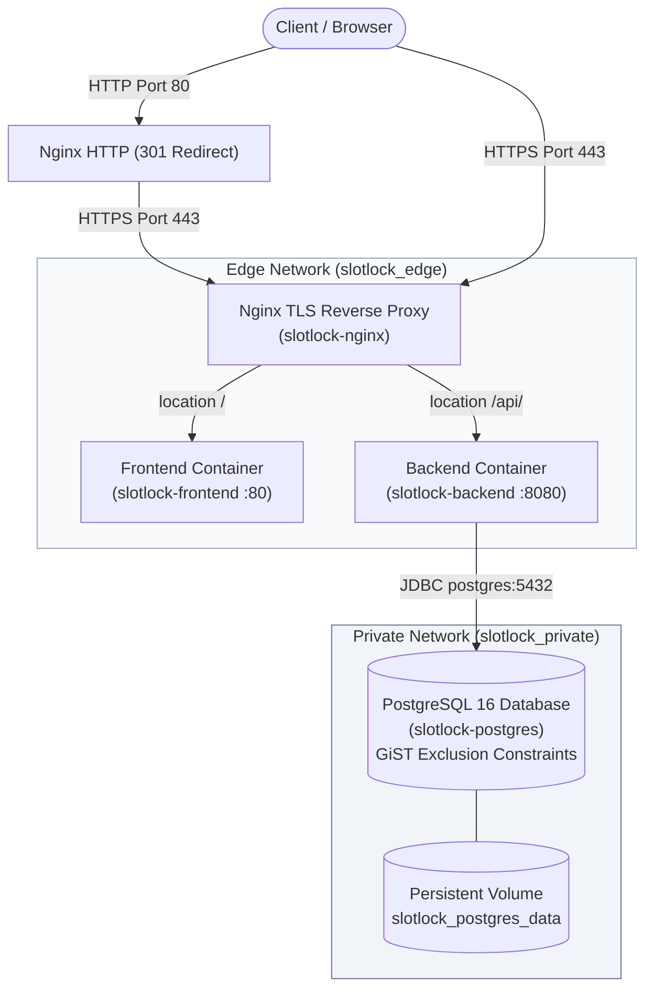

# SlotLock

SlotLock is a production-ready, conflict-free hall and timeslot booking system featuring strict concurrency guarantees, an edge Nginx TLS reverse proxy, a Spring Boot 3 API with PostgreSQL GiST exclusion constraints, and a responsive React 18 frontend.

---

## Architecture Flow

### System Diagram (Textual)

```text
[ Client Browser ]
        │  (HTTP :80 -> 301 Redirect)
        │  (HTTPS :443 TLS)
        ▼
┌────────────────────────────────────────────────────────┐
│  slotlock-nginx (Edge Reverse Proxy :80, :443)         │
│  Networks: edge (bridge)                               │
└──────────────┬──────────────────────────┬──────────────┘
               │                          │
        /      │                          │ /api/
        ▼      ▼                          ▼
┌──────────────────────────┐    ┌────────────────────────────────────────┐
│ slotlock-frontend (:80)  │    │ slotlock-backend (:8080)               │
│ React 18 + Vite SPA      │    │ Spring Boot 3 + Java 21 (Non-root user)│
│ Networks: edge           │    │ Networks: edge, private                │
└──────────────────────────┘    └──────────────────┬─────────────────────┘
                                                   │
                                                   │ Private JDBC connection
                                                   │ (:5432 internal only)
                                                   ▼
                                ┌────────────────────────────────────────┐
                                │ slotlock-postgres (PostgreSQL 16)      │
                                │ Networks: private (isolated, no host)  │
                                │ Volume: slotlock_postgres_data         │
                                └────────────────────────────────────────┘
```

### Mermaid Diagram



---

## Tech Stack

| Layer | Technologies |
|---|---|
| **Edge Proxy** | Nginx 1.27 (Alpine), TLS 1.2/1.3, OpenSSL self-signed local certs |
| **Frontend** | React 18, TypeScript (strict), Vite, React Router v6, TanStack Query v5, Plain CSS tokens (no Tailwind/UI kits) |
| **Backend** | Java 21 (Temurin), Spring Boot 3.4.3, Spring Data JPA, Spring Security (JWT HS256), Flyway 10, Actuator |
| **Database** | PostgreSQL 16 with `btree_gist` extension, HikariCP connection pool |
| **Containerization** | Docker, Docker Compose, Multi-stage builds, non-root runtime users |
| **CI/CD** | Jenkins Declarative Pipeline (`Jenkinsfile`) |

---

## Repository Layout

```
slotlock/
├── .env.example              # Environment variables template
├── .gitignore                # Ignores .env, *.pem, nginx/certs/, target/, node_modules/
├── docker-compose.yml        # Production multi-container composition (edge + private networks)
├── docker-compose.dev.yml    # Development single-container Postgres composition
├── Jenkinsfile               # Declarative 7-stage CI/CD pipeline
├── README.md                 # Project architecture, documentation, and operations
├── backend/
│   ├── .dockerignore         # Excludes target/, .git, .env, *.log
│   ├── Dockerfile            # Multi-stage: maven:3.9.9 -> eclipse-temurin:21 JRE (appuser, curl healthcheck)
│   ├── pom.xml               # Spring Boot 3.4.3 dependencies
│   └── src/
│       ├── main/java/com/slotlock/
│       │   ├── auth/         # Login, registration, /api/auth/me
│       │   ├── booking/      # Booking entity, repository, service, controller
│       │   ├── common/       # Global exception handling (SQLState 23P01/40P01 -> 409)
│       │   ├── hall/         # Hall management and listings
│       │   ├── security/     # JWT filter, authentication provider, security rules
│       │   └── user/         # User entity, role enum, admin auto-initialization
│       └── test/             # 50-thread concurrency proof and edge-case integration tests
├── frontend/
│   ├── .dockerignore         # Excludes node_modules/, dist/, .git, .env
│   ├── Dockerfile            # Multi-stage: node:20.18-alpine -> nginx:1.27-alpine
│   ├── nginx.conf            # SPA fallback configuration for React Router
│   ├── package.json          # React 18, React Router, TanStack Query, ESLint, Prettier
│   └── src/
│       ├── api/              # Typed API client, error handlers (SlotTakenError), auto-logout
│       ├── context/          # Auth context and session management (sessionStorage)
│       ├── components/       # App shell layout, protected and admin route guards
│       └── pages/            # Login, Register, Halls, HallDetail (timeline track), MyBookings, Admin
├── nginx/
│   └── nginx.conf            # Edge reverse proxy configuration (HTTP redirect, SSL termination, proxy headers)
├── docs/
│   └── evidence.txt          # Full deployment verification output (ps, logs, stats, persistence, isolation)
└── scripts/
    ├── gen-cert.ps1          # Self-signed TLS certificate generation via alpine/openssl container
    ├── smoke.ps1             # End-to-end smoke test through HTTPS edge
    ├── evidence.ps1          # Automated proof script for persistence and network isolation
    ├── start-backend.ps1     # Local standalone backend launcher
    └── test.ps1              # Local Maven test runner with environment injection
```

---

## Run the Full Stack (3 Commands)

From the project root in PowerShell:

```powershell
# 1. Prepare local environment configuration
Copy-Item .env.example .env

# 2. Generate self-signed TLS certificates for localhost
powershell -ExecutionPolicy Bypass -File scripts/gen-cert.ps1

# 3. Build and launch all services in background
docker compose up -d --build
```

Access the application:
- **Web UI**: [https://localhost](https://localhost) (Accept self-signed certificate in browser)
- **HTTP Redirect**: `http://localhost` automatically redirects to `https://localhost`
- **Default Admin Credentials**:
  - Email: `admin@slotlock.local`
  - Password: `AdminPassword123!`

---

## Concurrency Guarantee & The 50-Thread Proof

### How the No-Double-Booking Constraint Works

SlotLock guarantees zero overlapping bookings without relying on error-prone application-level locks or pre-flight SELECT queries:

1. **PostgreSQL GiST Exclusion Constraint**:
   Flyway migration `V1__init_schema.sql` enables `btree_gist` and enforces:
   ```sql
   ALTER TABLE bookings
   ADD CONSTRAINT no_overlapping_bookings
   EXCLUDE USING gist (
       hall_id WITH =,
       tstzrange(start_time, end_time) WITH &&
   ) WHERE (status IN ('PENDING', 'APPROVED'));
   ```
2. **Half-Open Intervals**: `tstzrange` treats intervals as `[start_time, end_time)`. This naturally permits adjacent back-to-back bookings (e.g., 10:00–11:00 and 11:00–12:00) while strictly prohibiting any fractional overlap.
3. **Instant Slot Freeing on Cancellation / Rejection**: Because the partial index applies only `WHERE (status IN ('PENDING', 'APPROVED'))`, updating a booking to `CANCELLED` or `REJECTED` instantly drops it from the exclusion constraint, freeing the slot for other students without deleting historical records.
4. **Database Source of Truth**: When an overlap is attempted, PostgreSQL immediately raises SQLState `23P01` (exclusion violation) or `40P01` (deadlock). `GlobalExceptionHandler` catches this and maps it to HTTP 409:
   ```json
   { "error": "SLOT_TAKEN" }
   ```

### The 50-Thread Proof Test

An integration test (`com.slotlock.BookingConcurrencyIntegrationTest`) verifies this concurrency guarantee against real PostgreSQL:
- 50 concurrent threads are initialized and primed.
- A `CountDownLatch` releases all 50 threads simultaneously against the same hall and timeslot.
- **Result**:
  - Exactly **1 &times; HTTP 201 (Created)**
  - Exactly **49 &times; HTTP 409 (Conflict - SLOT_TAKEN)**
  - Exactly **0 unexpected responses**

---

## Docker Files Specification

- **`backend/Dockerfile`**:
  - **Stage 1 (Build)**: Pinned `maven:3.9.9-eclipse-temurin-21`. Copies `pom.xml` first and runs `mvn dependency:go-offline -B` for Docker layer caching. Then copies `src/` and builds the production jar skipping tests.
  - **Stage 2 (Runtime)**: Pinned `eclipse-temurin:21.0.6_7-jre-alpine`. Installs `curl` for container healthchecks, creates an unprivileged non-root user (`appuser` in `appgroup`), copies only the built jar, exposes port 8080, and runs with UTC timezone (`-Duser.timezone=UTC`).
  - **Healthcheck**: `curl -f http://localhost:8080/actuator/health || exit 1`.
- **`frontend/Dockerfile`**:
  - **Stage 1 (Build)**: Pinned `node:20.18-alpine`. Installs exact dependencies with `npm ci`, compiles TypeScript in strict mode, and builds production static bundles with Vite.
  - **Stage 2 (Runtime)**: Pinned `nginx:1.27-alpine`. Deploys static build artifacts to `/usr/share/nginx/html` and mounts `frontend/nginx.conf` containing SPA fallback rules (`try_files $uri $uri/ /index.html`).
- **`nginx/nginx.conf`**:
  - Listens on port 80 and returns a permanent 301 redirect to HTTPS.
  - Listens on port 443 with TLS 1.2/1.3 and mounts `./nginx/certs/cert.pem` and `./nginx/certs/key.pem`.
  - Proxies `/api/` to `http://backend:8080` with `Host`, `X-Real-IP`, `X-Forwarded-For`, and `X-Forwarded-Proto` headers.
  - Proxies `/` to `http://frontend:80`.
- **`docker-compose.yml`**:
  - Services: `nginx`, `frontend`, `backend`, `postgres`.
  - Only `nginx` publishes host ports (`80:80` and `443:443`).
  - Two isolated bridge networks: `slotlock_edge` (public proxy, frontend, backend) and `slotlock_private` (backend, postgres).
  - PostgreSQL has no host port bindings and is only reachable from backend on `slotlock_private`.
  - `postgres_data` persistent volume ensures zero data loss across container lifecycle.

---

## Reading Logs & Stats

```powershell
# View real-time container status
docker compose ps

# Follow logs from edge proxy and backend API
docker compose logs -f backend nginx

# View last 30 log lines
docker compose logs --tail 30 backend nginx

# Inspect container CPU, memory, and network I/O
docker stats --no-stream

# Run full automated evidence verification (persistence + network isolation)
powershell -ExecutionPolicy Bypass -File scripts/evidence.ps1
```

---

## Not Yet Done (Future Milestones)

The following items are intentionally deferred and have **not** been executed:

1. **Remote Cloud / AWS EC2 Deployment**:
   - Automated provisioning of an AWS EC2 instance, VPC security group configuration (allowing inbound ports 80/443 only), and domain DNS mapping.
   - Production TLS certificates via Let's Encrypt / Certbot (current deployment uses self-signed certificates generated for localhost).
2. **Live Jenkins Server Execution**:
   - The declarative `Jenkinsfile` has been written and syntax-validated, but **no live Jenkins server run was executed** because an active Jenkins master and remote agent infrastructure are not present in this local environment.
